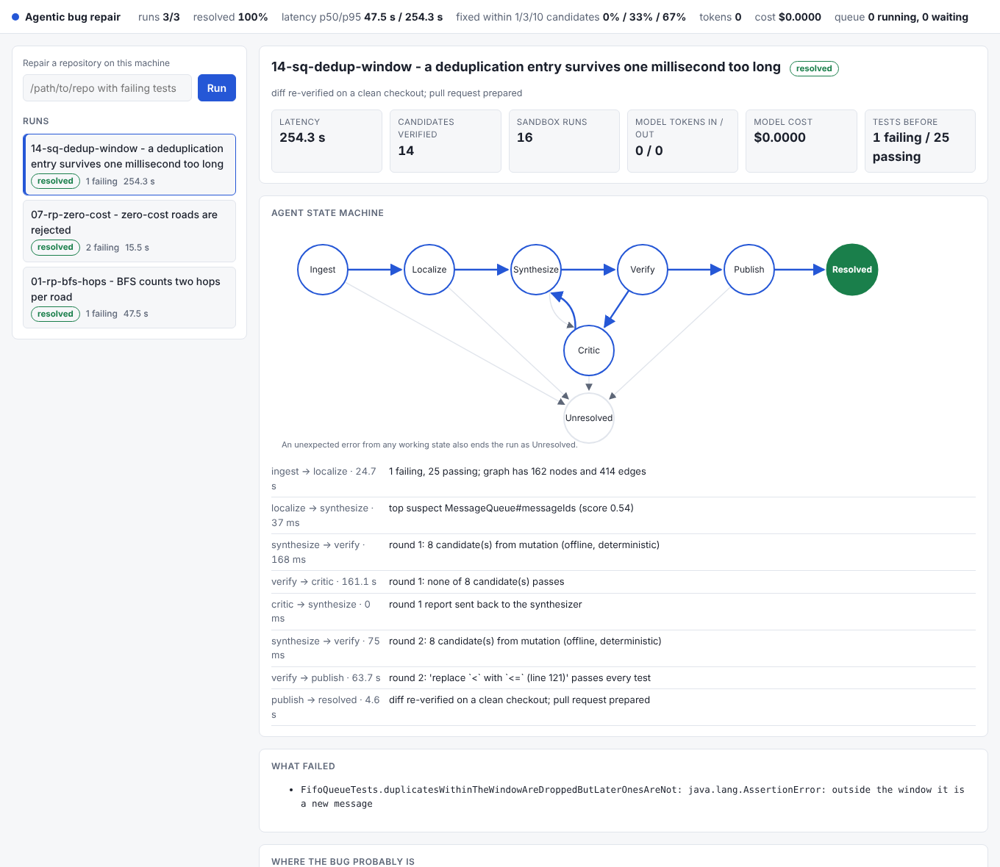

# agentic-bug-repair

[](https://github.com/Samvibhanshu/agentic-bug-repair/actions/workflows/ci.yml)

An agent that takes a Java repository with failing tests and tries to produce a **verified fix as a pull request**:
it indexes the code into a graph, measures which methods each test runs, localizes the bug, proposes a small unified diff, runs every candidate in an
isolated sandbox, feeds the failures back, and only publishes a diff that passes all tests on a clean checkout.
It can run from the command line, or as a service that reacts to failed GitHub builds and shows its work on a
dashboard. Java 17+, **no dependencies**: the JDK compiler API is the parser, `com.sun.net.httpserver` is the server.

The design follows SWE-agent / SWE-bench style systems, built small enough to read in a sitting (about 6,000 lines
of Java, 470 of browser code, 154 tests).



```bash
./build.sh                     # compile with -Xlint:all and run every test (needs a JDK 17+, git, bash)
java -cp out/main dev.samridhi.repair.Main demo        # dashboard on http://127.0.0.1:8080 with 3 bundled bugs being repaired
java -cp out/main dev.samridhi.repair.Main bench       # reproduce the benchmark below
```

A real run on a seeded bug (`addRoad` rejected a cost of 0 because it checked `<=` where `<` was needed), unedited output apart from the checkout path:

```
$ java -cp out/main dev.samridhi.repair.Main repair ./buggy-checkout
sandbox:     process sandbox: throwaway copy, empty environment, rlimits (memory, CPU, file size), process-tree watchdog, network namespace (no network)
synthesizer: mutation (offline, deterministic)
  INGEST     --READY--> LOCALIZE   (6620 ms)  2 failing, 17 passing; graph has 131 nodes and 335 edges; measured coverage for 19 tests
  LOCALIZE   --SUSPECTS_FOUND--> SYNTHESIZE (74 ms)  top suspect Graph#addRoad (score 0.98)
  SYNTHESIZE --CANDIDATES_READY--> VERIFY     (158 ms)  round 1: 8 candidate(s) from mutation (offline, deterministic)
  VERIFY     --ALL_TESTS_PASS--> PUBLISH    (3613 ms)  round 1: 'replace `<=` with `<` (line 69)' passes every test
  PUBLISH    --PUBLISHED--> RESOLVED   (2430 ms)  diff re-verified on a clean checkout; pull request prepared

--- a/src/main/java/dev/samridhi/routes/Graph.java
+++ b/src/main/java/dev/samridhi/routes/Graph.java
@@ -66,7 +66,7 @@
     public void addRoad(int from, int to, int cost) {
         check(from);
         check(to);
-        if (cost <= 0) throw new IllegalArgumentException("negative cost " + cost + " on " + from + "->" + to);
+        if (cost < 0) throw new IllegalArgumentException("negative cost " + cost + " on " + from + "->" + to);
         Road r = new Road(from, to, cost);
         out.get(from).add(r);
         in.get(to).add(r);
```

## How it works

```
 failing build ──► webhook (HMAC-verified) ─┐                            ┌──────────── dashboard (live over HTTP/JSON) ───────────┐
 repair <repo>  ───────────────────────────┤                            │ state machine · suspects · blast radius · side-by-side │
 POST /api/runs ───────────────────────────┴─► bounded job queue ─► worker                 diff · one-click approve · telemetry     │
                                                  (429 when full)      │                                                       └──────┘
        ┌──────────────────────────────────────────────────────────────┘
        ▼
   INGEST ──► LOCALIZE ──► SYNTHESIZE ──► VERIFY ──► PUBLISH ──► RESOLVED          every state also has an ERROR edge to UNRESOLVED
   graph +     rank        candidate       sandbox     re-verify      (draft PR)
   baseline    suspects    unified diffs   per         the composed
   test run                + policy gate   candidate   diff on a
                              ▲               │        clean checkout
                              └── CRITIC ◄────┘  report: what still fails, what regressed, what did not compile
                                 (up to 3 self-correction rounds; a partial fix is kept and built on)
```

**Code graph** (`graph/JavaIndexer`). The JDK compiler (`com.sun.source`) parses *and attributes* every file, so a
call edge points to the exact overload that is called, not to a name match. Nodes are classes, methods and fields;
edges are `CALLS`, `IMPORTS`, `INHERITS` and `MODIFIES` (field writes). Calls through an interface or a method that is
overridden fan out to every implementation (class hierarchy analysis). Lambdas and anonymous classes are attributed
to the method that contains them. A repository that does not compile still yields a graph, plus the compile errors.

**Retrieval** (`retrieval/`, `localize/GraphRag`). Hybrid search over method bodies: Okapi BM25, a feature-hashed
bag-of-words/bigram vector (the `Embedder` interface is where a neural embedding model would plug in), merged by
reciprocal rank fusion. Around a suspect, a breadth-first traversal (2 hops by default) collects callers, callees,
the fields it writes and the tests that reach it; that neighbourhood, with line-numbered source, is what the
synthesizer sees.

**Measured coverage** (`coverage/`). After the baseline run, an instrumented copy of the repository is built and
tested once more: every method body starts with a probe (`repairprobe.RepairProbe.hit(id)`, on the same line as the
opening brace so stack traces keep their line numbers, and after `super(...)`/`this(...)` in constructors), and each
test reports which methods it actually executed. If the instrumented copy does not build or run, localization falls
back to the call graph, which over-approximates: it counts every method a test *could* reach.

**Fault localization** (`localize/FaultLocalizer`). Each non-test method gets a score in 0..1 from five signals:
*spectrum* (Ochiai suspiciousness over the measured coverage: methods the failing tests execute and the passing ones
do not), *stack frame* (position in the stack trace when the failure is a crash), *proximity* (call distance from the
failing test), *text* (retrieval match with the failure message) and *logic* (how much decision-making and arithmetic
the method contains; comments and strings ignored). The logic prior demotes setup methods, such as constructors and
getters, that only the failing tests happen to run but where a logic bug cannot live. Weights are `1.0/0.25/0/0.25/0.25`,
chosen on the dev split of the benchmark (below).

**Patch synthesis** (`synth/`). Pluggable behind `PatchSynthesizer`:

| Synthesizer | Needs | What it does |
|---|---|---|
| `MutationSynthesizer` (default) | nothing | Enumerates single-edit changes (13 operators: flip `<`/`<=`, `+`/`-`, `&&`/`\|\|`, off-by-one constants, array index, negated condition, swapped arguments, …) inside the top suspects, ranks them by operator prior × suspect score, boosts the line in the stack trace. Deterministic, free, offline. |
| `LlmSynthesizer` | `ANTHROPIC_API_KEY` | Prompt = failing tests + suspect with line numbers + 2-hop graph context + critic feedback; asks for one diff; **dry-run applies it** before returning it, and tells the model why a diff was rejected. |
| `CascadeSynthesizer` | both | Mutations for the first 2 rounds, the model only when they are exhausted, so most small bugs cost no tokens. |

**Gate and verification** (`agent/PatchPolicy`, `agent/Verifier`). Before anything runs, a patch must modify only
existing non-test source files and at most 40 lines: the agent cannot "fix" a test by editing it, or by touching the
build script or CI. Each candidate is applied to a copy, built and tested in a sandbox, and compared with the
baseline: which tests it fixed, which previously-passing tests it broke, how many new compiler warnings. Only a
candidate with all tests green, nothing broken and no new warnings counts. Candidates run in parallel waves in rank
order. A candidate that loops forever is killed after a multiple of the healthy test time, not after the global limit.
If no candidate passes but one fixes *some* failing tests without breaking any, it is **accepted as a partial fix**,
the graph is rebuilt, suspects are re-ranked, and the next round starts from there. The diff that is finally
published is composed against the pristine checkout and **verified once more on a clean copy**.

**Sandboxes** (`sandbox/`).

| | `ProcessSandbox` (default) | `DockerSandbox` (used automatically when a Docker daemon answers) |
|---|---|---|
| Filesystem | throwaway copy of the repo, deleted afterwards | repo mounted `:ro`, copied into a tmpfs; root filesystem read-only |
| Network | private network namespace via `unshare -rn` when the kernel allows it (the banner says so when it does not); only its own loopback is brought up, so a test can talk to a server it starts itself | `--network none` |
| CPU / memory / processes | `ulimit` address space, CPU seconds, file size; watchdog kills the process tree on timeout or when it exceeds the process limit | cgroup `--memory`, `--memory-swap`, `--cpus`, `--pids-limit` |
| Privileges | environment emptied (no tokens or keys inherited) | `--cap-drop ALL`, `no-new-privileges`, user 65534 |
| Output | capped at 1 MiB, the rest drained so the child never blocks | same |

`ProcessSandbox` is a convenience for trusted code on a dev machine. **Use Docker for code you do not trust.** The Docker
sandbox runs `eclipse-temurin:17-jdk` with no network, so pull the image first and make sure the project builds on Java 17.
The process sandbox needs Linux (`bash`, `ulimit`, optionally `unshare`); it has not been tried on macOS or Windows.

**Service** (`serve`). `POST /webhooks/github` accepts `workflow_run` and `check_suite` events: the HMAC-SHA256
signature is checked in constant time over the raw bytes before the body is parsed, deliveries are de-duplicated by
`X-GitHub-Delivery`, only repositories on an allow-list are cloned, and the clone URL is built from the repository
name, never taken from the payload. Work goes through a bounded queue; when it is full the sender gets `429` with
`Retry-After`. Finished runs are archived as JSON so the dashboard keeps its history across restarts.

**Pull requests** (`pr/`). Without `GITHUB_TOKEN` the publisher writes `PR.md` and `fix.patch`. With it, clicking
*Approve* clones the checkout, creates `autofix/<run id>`, applies the diff, commits, pushes, and opens a **draft**
PR whose description lists where the agent looked (the three top suspects with their signal scores), the diff, the
blast radius (callers and tests), how it was verified, and the cost.

**Dashboard** (`src/main/resources/web`). Vanilla JS, no build step, served by the JDK. The live state machine (visited
and current states highlighted), the event log with per-state timings, the ranked suspects with the evidence for
each, an interactive blast-radius graph, every candidate tried with its verdict, a side-by-side diff with a
download link and the approve button, the generated PR text, the isolation actually in force, and a telemetry bar:
runs, resolve rate, latency p50/p95, token cost, and "solved within 1/3/10 candidates". Light and dark themes, works
at phone width, strict CSP (no inline scripts; all dynamic text is inserted as text).

| | |
|---|---|
| `repair <repo> [--cmd "bash build.sh"] [--iterations 3] [--beam 8] [--out dir]` | one-shot; exits 1 if unresolved |
| `serve [--port 8080] [--host 127.0.0.1] [--data ./data] [--root DIR]… [--repo owner/name]…` | webhook server + dashboard |
| `demo [--cases 01,07,14]` | `serve` plus a few bundled buggy projects; never contacts GitHub |
| `bench [--mode localize\|repair\|both\|tune] [--cases 01,02]` | benchmark |

Environment: `ANTHROPIC_API_KEY` (and `REPAIR_MODEL`, default `claude-sonnet-5-5`), `GITHUB_TOKEN`, `WEBHOOK_SECRET`,
`REPAIR_API_KEY` (required to bind anything other than loopback). The test command is any command that compiles,
runs the tests and prints `PASS`/`FAIL` lines the way the bundled testkit does (`--cmd` changes it); `trace/TestOutputParser`
is the one place that would change to read JUnit output.

## Measured results

`bench/` holds **20 seeded bugs** in three small Java repositories (`route-planner`, `order-service`, `mini-sqs`), each a
`bug.patch` with the true buggy method recorded, split into 10 *dev* and 10 *test* cases. Full tables:
[`bench/results/RESULTS.md`](bench/results/RESULTS.md). Measured on 2 CPU cores, with other work running at the same
time, so latencies are upper bounds.

**Where is the bug?** Rank of the true buggy method among the suspects (an `AssertionError` has no useful stack, so the
trace-only baseline is nearly blind; that is the realistic situation for logic bugs):

| Signals | top-1 | top-3 | top-5 | MRR | MRR dev | MRR test |
|---|---|---|---|---|---|---|
| stack trace only (baseline) | 15% | 15% | 15% | 0.15 | 0.10 | 0.20 |
| text search only | 15% | 30% | 35% | 0.28 | 0.29 | 0.26 |
| trace + text (no coverage) | 25% | 30% | 45% | 0.34 | 0.30 | 0.38 |
| spectrum only, call-graph coverage | 15% | 30% | 45% | 0.31 | 0.30 | 0.31 |
| spectrum only, measured coverage | 30% | 45% | 75% | 0.48 | 0.50 | 0.45 |
| all signals, old weights (the previous default) | 20% | 40% | 40% | 0.34 | 0.32 | 0.36 |
| tuned weights + logic prior, call-graph coverage | 40% | 70% | 80% | 0.57 | 0.57 | 0.57 |
| **tuned weights + logic prior, measured coverage (default)** | **55%** | **70%** | **80%** | **0.66** | 0.72 | **0.61** |

The weights were chosen by a grid search on the **dev split only** (`bench --mode tune`); the test split was not used
to choose anything. On the held-out test split, MRR went from 0.36 (previous default) to 0.61.

**Can it fix it?** (offline mutation synthesizer, no model, 3 self-correction rounds)

| | before | now |
|---|---|---|
| Passes every test on a clean checkout | 4 / 20 | **9 / 20** (dev 5, test 4) |
| ... and is actually correct (checked by hand) | 4 | **8** (7 restore the original source; 1 is equivalent to it) |
| Median / p95 time of resolved runs | 35 s / 142 s | 73 s / 140 s |

What the numbers do and do not say:

- **Measured coverage made the spectrum signal useful.** Alone, it went from MRR 0.31 (call-graph coverage) to 0.48:
  the call graph counts every method a test *could* reach, so in large classes with integration-style tests the
  failing tests "reach" dozens of methods and Ochiai cannot tell them apart.
- **Most of the gain came from re-weighting, not from measured coverage.** With the tuned weights and the logic prior,
  call-graph coverage already scores 0.57 on both splits; measured coverage adds 0.15 on dev but only 0.04 on test (one
  bug moving up a place or two). With 10 bugs per split, that last difference is within noise.
- **One "fix" is wrong, and the tests did not notice.** For `04-rp-two-opt-hang` (2-opt looped forever when two tours
  cost the same) the agent changed `i < best.length - 1` to `i > best.length - 1`, which disables 2-opt entirely: no
  more hang, every test passes, and the planner silently returns worse routes. The benchmark copy of the route
  planner's tests checks that 2-opt terminates and never makes a tour worse, but not that it improves one. This is the
  well-known overfitting problem of test-based repair, and the reason pull requests are drafts that a person approves.
- **Where it still fails.** 0 of the 5 bugs that need new code were fixed (as expected of a one-edit synthesizer).
  Of the 6 one-edit bugs not fixed, 5 have the true method ranked 4th to 11th, below the three suspects the
  synthesizer mutates (all in `order-service` and `mini-sqs`, whose classes are large); in the sixth (`02`) it is ranked
  first, and no single mutation within the candidate budget passed.
- One real bug found earlier by this benchmark: the process sandbox's network namespace had its loopback device
  switched off, so `order-service`'s HTTP tests could never pass inside it. That is fixed and tested.
- The bugs were seeded by the author of the tool. They are plausible logic bugs, not a sample of real-world ones, and they are far
  easier than SWE-bench issues. **These figures are not comparable with SWE-bench scores.**
- The model-backed path has no benchmark numbers: it was not run against the live API.

## Verification

`./build.sh` runs 154 tests. Notable ones:

- coverage instrumentation is checked on real code: probes keep every line number, constructors that call `super(...)` still compile, and per-test coverage matches the methods each test is known to run;
- the diff engine is checked against `git apply` in both directions (including a 120-case fuzz), and refuses path traversal and partial application;
- the state machine's table is checked for reachability, terminal states, and an `ERROR` edge from every working state;
- the pipeline is run end to end on a seeded bug, and with scripted synthesizers for: critic feedback reaching round 2, a regression being refused, a patch that edits a test being rejected before the sandbox, a partial fix in one file combined with the winning fix in another, a candidate that loops forever, a final diff that fails re-verification, an unreachable model API;
- the sandbox tests check isolation, not just success: the caller's directory is untouched, no secrets in the environment, children die with the parent, a fork bomb trips the limit, runaway output is capped, memory hogs are stopped, and (where the kernel allows) the network namespace has only a loopback device;
- the service tests cover the full path webhook → clone from a local bare repo → repair → approve → files on disk over real HTTP, every webhook status code, duplicates, backpressure, oversized bodies, API keys, and the browser-attack checks below;
- the GitHub publisher is tested against a local bare remote and a stub of the REST API: the branch contains exactly one commit with the fix, `main` is untouched, the PR is a draft, and the token never appears in an error message;
- the benchmark data is checked too: every `bug.patch` applies, compiles, targets a method that exists, and every target is green before a bug is planted.

I also planted 14 bugs in the code itself (weakened signature check, removed policy check, wrong percentile, skipped final re-verification, dropped partial-fix file, `--network bridge`, …) to see whether the tests notice. They did, after I added two tests for the two that first survived.

## Security notes

- Webhook: constant-time HMAC over the raw body first; delivery de-duplication; repository allow-list; clone URL never from the payload; branch and SHA validated against strict patterns.
- API: state-changing calls need `Content-Type: application/json` (which forces a CORS preflight this server never grants), an `Origin` header must match `Host`, and without an API key the `Host` must be a loopback name (CSRF and DNS rebinding). Binding a non-loopback address without `REPAIR_API_KEY` is refused at startup. Bodies over 2 MB get `413`. `POST /api/runs` can only read directories under `--root`.
- The GitHub token travels in environment variables (`GIT_CONFIG_*`), not on a command line, and is scrubbed from every error message.
- Responses carry `X-Content-Type-Options: nosniff`; the dashboard is served with `default-src 'self'`.
- A patch can only change existing non-test source files, so the agent cannot rewrite the tests, the build or the CI to make them pass.

## Layout

```
src/main/java/dev/samridhi/repair/
  graph/      code property graph (JDK compiler API)        retrieval/  BM25, hashed vectors, rank fusion
  localize/   fault localizer, GraphRAG context              synth/      mutation, LLM, cascade, Anthropic client
  agent/      state machine, pipeline, policy, verifier      sandbox/    process and Docker sandboxes
  patch/      unified diff create / parse / apply            pr/         dry-run and GitHub publishers
  service/    webhook, queue, HTTP API, run store            metrics/    pass@k, percentiles, cost
  bench/      benchmark harness                              trace/      test output and stack trace parser
  coverage/   probe instrumentation, per-test coverage
src/main/resources/web/   dashboard          bench/   targets, 20 cases with bug.patch, results
```
